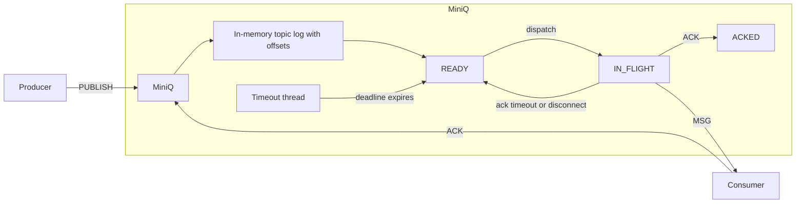
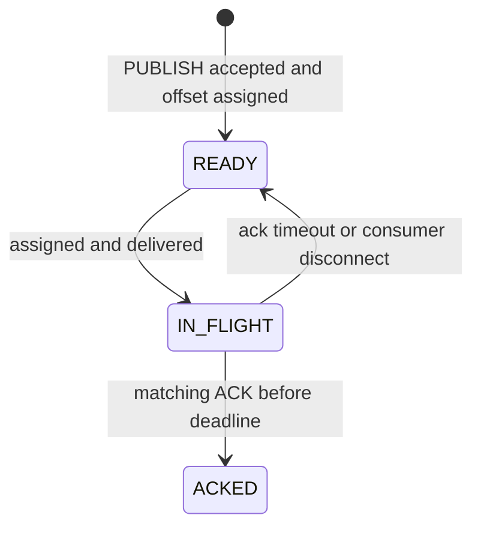

# MiniQ

MiniQ is a lightweight local broker so developers can test event-driven Spring Boot apps without installing Kafka.

## Status

**v0.1 is IN-MEMORY ONLY.** Messages do not survive a broker restart. Persistence is planned for v0.2.

## Quickstart

Run these commands from the repository root:

```sh
mvn -q -DskipTests package
java -jar miniq-server/target/miniq-server.jar
bash scripts/chaos-demo.sh
```

The server prints `MINIQ_READY port=<port>` when it is listening. The chaos demo uses the shaded server and chaos JARs produced by the build.

## Java client

```java
import dev.miniq.client.MiniQClient;

class Example {
    public static void main(String[] args) throws Exception {
        try (var client = MiniQClient.connect("127.0.0.1", 7070, 2_000)) {
            client.subscribe("orders", message -> System.out.println(message.payload()), true);
            long offset = client.publish("orders", "{\"id\":1}");
            System.out.println("published at offset " + offset);
        }}
}
```

The subscription handler receives each `Message`; `autoAck=true` acknowledges it after the handler returns successfully. Start the server with the quickstart command first; its default port is 7070.

## Wire protocol cheat sheet

MiniQ uses UTF-8 text over TCP, with one LF-terminated command or response per line. The three client commands are:

| Line | Meaning |
|---|---|
| `PUBLISH <topic> <payload>` | Append a message; response is `OK <offset>`. |
| `SUBSCRIBE <topic> [ackTimeoutMs]` | Subscribe to a topic; response is `OK`, then messages may arrive. Timeout defaults to 5,000 ms. |
| `ACK <topic> <offset> <deliveryCount>` | Acknowledge the current delivery attempt; response is `OK`. |
| `MSG <topic> <offset> <deliveryCount> <payload>` | Broker-pushed message delivery. |
| `OK [offset]` | Successful command response. |
| `ERR <code> <message>` | Rejected command or broker error. |

Example session, matching [the protocol specification](docs/PROTOCOL.md):

```text
C: PUBLISH orders {"id":1,"status":"new"}
S: OK 0
C: SUBSCRIBE orders
S: OK
S: MSG orders 0 1 {"id":1,"status":"new"}
C: ACK orders 0 1
S: OK
```

## Delivery guarantee

MiniQ provides at-least-once delivery. A message can be delivered more than once if it is not acknowledged before the ack timeout or the consumer disconnects. Redelivery can happen after either event. Ordering is not guaranteed after redelivery: a later message may arrive before an older message is retried.

## Architecture and message states





## Chaos demo

The Stage A demo proves at-least-once delivery through a consumer crash: it publishes IDs 1–1000, kills consumer A with SIGKILL after at least 500 distinct IDs have been logged, and lets a fresh consumer receive the remaining work. It verifies every ID appears at least once and reports duplicates and redeliveries. One sample run in [docs/CHAOS.md](docs/CHAOS.md) reports 1,008 total lines, 1,000 distinct IDs, 8 duplicates, and 8 redeliveries; counts vary by run. Stage B, which tests recovery after a broker crash, needs persistence and is not implemented yet.

## Scope and limitations

MiniQ is single-node and currently in-memory. It supports exactly three commands: `PUBLISH`, `SUBSCRIBE`, and `ACK`. There is no authentication, consumer-group support, or persistence yet. See [FUTURE.md](FUTURE.md) for planned work and [docs/](docs/) for design, protocol, and chaos documentation.

## Project layout

| Module | Purpose |
|---|---|
| `miniq-core` | In-memory broker, topics, delivery state, and timeout scheduling; no Spring dependency. |
| `miniq-server` | TCP server and line protocol; builds `miniq-server.jar`. |
| `miniq-client` | Plain-JDK TCP client with handler-based subscription and auto-ACK. |
| `miniq-chaos` | Process-based chaos demo tools and acceptance tests; builds `miniq-chaos.jar`. |
| `miniq-spring-boot-starter` | Spring Boot integration module. |
| `demo-producer` | Sample producer application. |
| `demo-consumer` | Sample consumer application. |
| `miniq-benchmark` | Benchmark module. |

## CI status

[](https://github.com/<owner>/<repository>/actions/workflows/ci.yml) <!-- Replace <owner>/<repository> with the GitHub repository path. -->
